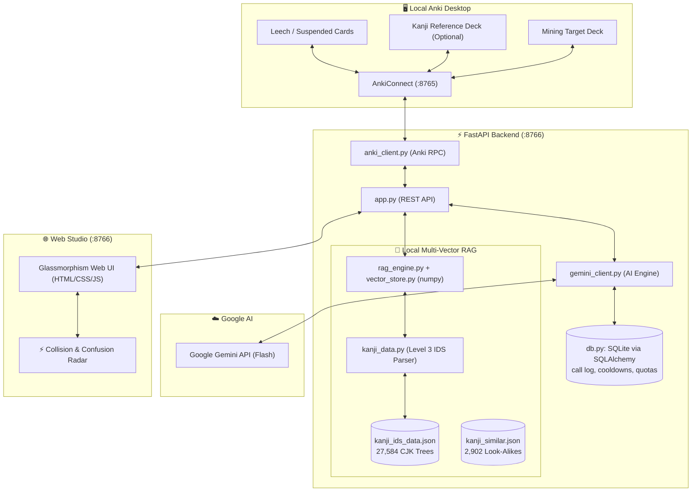

# ⚡ Anki Leech Doctor & Mnemonic Studio

[](https://opensource.org/licenses/MIT)
[](https://www.python.org/downloads/)
[](https://fastapi.tiangolo.com)
[](https://ai.google.dev/)
[](https://www.jlpt.jp/e/)

> **An open-source AI copilot for Anki that turns stubborn Japanese vocabulary "leeches" and mined words into indelible memory anchors through personalized mnemonics, customizable JLPT levels, and multi-persona example sentences.**

---

## 🎯 The Problem & Why Leech Doctor Exists

Studying Japanese with comprehensive Anki vocabulary decks (e.g., *Ankidrone Essentials*, *JLPT Tango*, *Core 2k/6k*, *Kaishi 1.5k*) inevitably produces **"leech cards"**—words repeatedly forgotten and suspended by Anki's leech threshold.

Most learners either:
1. **Endure endless review loops** with confusing or generic dictionary example sentences.
2. **Manually search Kanji reference decks** (such as *Remembering the Kanji (RTK)* or *NihongoShark*) to look up constituent radicals and keywords—a slow, friction-heavy process.
3. **Struggle with sentence complexity** that is either far too easy or packed with unlearned high-level kanji.

**Anki Leech Doctor** solves this by establishing a live, bidirectional link with your local Anki instance. It extracts constituent kanji, retrieves your personal kanji stories or decomposes radicals on-the-fly, synthesizes vivid composite mnemonics with phonetic reading puns, generates personalized example sentences calibrated to your target JLPT level, and writes everything back to Anki with a single click.

---

## 🚀 Key Features

### 1. 🎛️ Dynamic JLPT Difficulty Calibration (N5 to N1)
- Instantly toggle your target difficulty level in the navbar: **JLPT N5, N4, N3, N2, N1**, or **General Conversational**.
- Automatically calibrates the AI's grammar complexity, vocabulary ceiling, and Sensei diagnostic feedback.

### 2. ✨ Multi-Persona Mnemonic Synthesis
Choose from 4 distinct mnemonic generation modes:
- **🤪 Playful & Absurd**: High-energy humor, vivid modern scenarios, pop culture, and phonetic sound-alike reading puns (e.g. *aite* $\to$ *"Ah, I TIE!"*).
- **🏛️ Historical & Etymological**: Authentic kanji history, ancient pictographic roots, and radical derivations.
- **🎬 Cinematic**: High-intensity, sensory-rich dramatic storytelling.
- **🧘 Minimalist**: Ultra-condensed rapid flashcard links.

### 3. 🀄 Universal Kanji & RTK Strategy
- **Hybrid Mode**: Seamlessly pulls your personal stories and keywords from your Anki Kanji deck (e.g., *01 NihongoShark.com: Kanji* or *RTK*). If a kanji isn't in your deck (e.g. `嬉`), the AI automatically decomposes it and synthesizes a mnemonic on the fly without hallucination.
- **✨ AI Decomposition Only**: No kanji deck installed? No problem! The AI breaks down any kanji into its fundamental radicals dynamically.

### 4. ⛏️ 1-Click Vocabulary & Grammar Mining
- **Vocab**: input any Japanese word or phrase (e.g., `限界`, `見失う`, `一目惚れ`, `バイク`). The AI resolves canonical kanji, bracket furigana, a concise definition, constituent kanji stories, and pitch accent.
- **Grammar**: input a pattern (e.g., `〜ばかり`, `〜ようにする`) and optionally the sentence where you saw it. The AI writes the meaning, formation rule, nuance and look-alike patterns into the card's notes.
- **JLPT level for grammar**: *Auto* lets the AI place the pattern (N5–N1); pick a level to override it. Grammar cards go to `<grammar deck base>::<level>` (default `Mining::Grammar::N4`, etc.) and are tagged `grammar` and `jlpt::N4`.
- **Example sentence from your personas**: the card's example sentence is written by the Persona Sentence Studio using your active interests, and marked as already generated.
- Preview and edit the draft before adding it to your mining deck (default `Mining`, created if missing). See [Mining note type](#-mining-note-type) for which note type is used.

### 5. 🏍️ Multi-Persona Sentence Studio
- **Persona Pool**: Activate interest tags (e.g., *💻 Software Engineering*, *🏍️ Motorcycle Mechanics*, *⚡ Absurd Comedy*, *🚀 Dark Sci-Fi*, *🍜 Izakaya Food*, *🏋️ Gym & Fitness*, or custom tags).
- **Intelligent Thematic Selection**: The AI evaluates the vocabulary word and picks the most natural, memorable context from your active pool.
- **Clean HTML Formatting**: Generates clean ruby furigana (`単語[たんご]`) and automatically clears obsolete audio fields (`SentAudio`) upon sentence replacement.

### 6. 💬 Interactive Sensei Study Copilot
- Ask why you keep failing a specific card or confusing it with similar synonyms.
- Assess whether a word is essential for your JLPT level and real-world conversation vs. an outdated edge case.

### 7. ⚡ Deck Collision & Confusion Radar (Multi-Vector RAG)
- **Zero-Quota Local Tri-Vector Search**: Combines **Semantic** (TF-IDF keyword vectors), **Visual** (Kanji radical and spatial trees), and **Phonetic** (Romaji/Mora edit distance) vectors across your local Anki decks without using external API quota.
- **Exact Duplicate Detection & Prioritization**: Automatically surfaces identical vocabulary across multiple decks (e.g., Tango N5 vs. Tango N3) and pins exact duplicates to the top of your review.
- **Multi-Card Contrast Checkboxes**: Select 1 to N confusable cards in the radar to generate a single unified mnemonic that explicitly contrasts differing radicals, nuances, and pronunciation puns across all selected words.

### 8. 🌳 Level 3 Hierarchical Unicode IDS Spatial Tree Decomposition
- **Syntax Tree Radical Decomposition**: Decomposes **27,584 CJK characters** using the 12 official Unicode Ideographic Description Characters (`⿰` Left-Right, `⿱` Top-Bottom, `⿴` Full Enclosure, `⿺` Surround, etc.).
- **Subtree & Branch Alignment**: Detects when look-alike kanji share identical structural branches (e.g. `待` and `持` sharing the right branch `寺` = `⿱土寸`).
- **Positional Component Inversion**: Identifies single-kanji anagrams and reversed components (e.g. `呆` `[⿱口木]` vs `杏` `[⿱木口]`) as topological inversions.
- **Data Architecture (Clean & 100% Data-Driven)**:
  1. **Level 3 Spatial Tree Engine**: `kanji_ids_data.json` (27,584 characters from the MIT-licensed [yi-bai/ids](https://github.com/yi-bai/ids) dataset; see [`DATA_SOURCES.md`](DATA_SOURCES.md)).
  2. **Look-alike Kanji**: `kanji_similar.json` (2,902 characters mapped to visually similar kanji such as `鳥` vs `烏`, `日` vs `白`, `大` vs `犬`), built from the MIT-licensed [similar-kanji](https://github.com/siikamiika/similar-kanji) lists.

### 9. 📝 Direct Note Editing & 1-Click Anki Sync
- **Inline Editors**: Edit notes (<kbd>E</kbd>) or example sentences directly in the interface.
- **🟢 Unsuspend & Unleech**: Removes the `leech` tag and unsuspends the card into your active review queue.

---

## ⌨️ Keyboard Shortcuts

| Shortcut | Action |
| :--- | :--- |
| <kbd>←</kbd> / <kbd>→</kbd> | Navigate between cards |
| <kbd>Space</kbd> | Generate Composite Mnemonic |
| <kbd>E</kbd> | Toggle Direct Notes Editor |
| <kbd>S</kbd> | Save Mnemonic to Anki Notes |
| <kbd>U</kbd> | Unsuspend Card & Clear Leech Tag |
| <kbd>N</kbd> or <kbd>M</kbd> | Open "Mine New Word" Modal |
| <kbd>A</kbd> | Add Mined Draft Card to Anki |
| <kbd>D</kbd> | Delete Card (asks first) |
| <kbd>Z</kbd> | Undo Last Unsuspend |
| <kbd>Esc</kbd> | Close Modal / Discard |

---

## 🛠️ Architecture



### Local data

| What | Where | How |
| :--- | :--- | :--- |
| Your cards | Anki | Read and written only through AnkiConnect |
| Settings | `config.json` | JSON |
| Collision Radar index | `.rag_storage/vectors.npz` | numpy, replaced atomically on each sync ([0001](docs/design/0001-numpy-vector-index.md)) |
| Gemini call log, model cooldowns, learned daily limits | `leech_doctor.db` | SQLite via SQLAlchemy 2.0, schema managed by Alembic ([0002](docs/design/0002-gemini-call-log.md)) |

The database is created and migrated automatically on startup. **Settings → Gemini Usage Today** shows what it knows: requests per model since the daily quota reset, median latency, learned limits and cooldowns.

Design decisions, with measurements, are recorded in [`docs/design/`](docs/design/).

---

## 📦 Deck Compatibility Guide

Anki Leech Doctor works out of the box with virtually any Japanese Anki collection:

| Deck Type | Compatible Decks / Sources | Notes |
| :--- | :--- | :--- |
| **Vocabulary Decks** | *Ankidrone Essentials (V1–V8)*, *JLPT Tango (N5–N1)*, *Core 2k/6k/10k*, *Kaishi 1.5k/2k*, *Jalup*, *Nayr's 5k*, custom user decks | Supports standard fields (`VocabKanji`, `VocabFurigana`, `VocabDef`, `SentKanji`, `SentFurigana`, `SentEng`, `Notes`) with automatic fallback mapping (`Expression`, `Reading`, `Meaning`, `Sentence`). |
| **Kanji Reference Decks** | *01 NihongoShark.com: Kanji*, *Heisig RTK 1–3*, *All in One Kanji*, *Wanikani*, or **None (AI On-The-Fly Mode)** | Reads custom story fields (`myStory`, `koohiiStory1`, `heisigStory`, `keyword`). |
| **Mining Note Types** | `Japanese sentences` (default), or any note type whose fields can be matched | See [Mining note type](#-mining-note-type). |

### 🗂️ Mining note type

Mined cards use the **`Japanese sentences`** note type by default (the one used by *Ankidrone Essentials*). To use another note type, set **Mining Note Type** in Settings. Fields are matched by name:

| Role | Field names tried (in order) |
| :--- | :--- |
| Word | `VocabKanji`, `Expression`, `Word`, `Kanji`, `Front` |
| Reading | `VocabFurigana`, `Reading`, `Furigana`, `Word Reading` |
| Meaning | `VocabDef`, `Meaning`, `Glossary`, `English`, `Word Meaning`, `Back` |
| Sentence | `SentKanji`, `Sentence`, `Example` |
| Sentence reading | `SentFurigana`, `SentenceReading`, `Sentence Furigana` |
| Sentence translation | `SentEng`, `SentenceMeaning`, `SentenceEng`, `Sentence Meaning` |
| Notes / mnemonic | `Notes`, `Comment` |

If your note type uses other names, map them in `config.json`:

```json
"miningNoteType": "My Japanese Note",
"miningFieldMap": { "vocabKanji": "Target", "vocabDef": "Definition", "notes": "Hint" }
```

Roles without a matching field are skipped. The note type must have a field for the word.

---

## 🚀 Quickstart Guide

### Prerequisites
1. **Anki Desktop**: Running locally with the [AnkiConnect](https://ankiweb.net/shared/info/2055492153) add-on installed (Code: `2055492153`). No AnkiConnect CORS changes are needed: only the local server talks to Anki.
2. **Python 3.12 or newer** (tested on 3.12–3.15). Use the latest patch release of your version, since that's where security fixes land.
3. **Gemini API Key**: Get a free API key from [Google AI Studio](https://aistudio.google.com/app/apikey). The free tier has low daily limits per model; when the configured model is out of quota the app falls back to other Flash models automatically.

### 1. Clone & Install
```bash
git clone https://github.com/tstinebaugh/anki-leech-doctor.git
cd anki-leech-doctor
python3 -m venv .venv      # python3 must be 3.12+, e.g. python3.14 -m venv .venv
source .venv/bin/activate  # Windows: .venv\Scripts\activate
pip install -r requirements.txt
```

### 2. Configure Settings
Copy the template configuration file and add your Gemini API key (or set the `GEMINI_API_KEY` environment variable):
```bash
cp config.example.json config.json
```
*(You can also configure everything from the Settings modal in the web UI.)*

Then open Settings and check the **Anki Deck Targets** section: your mining deck, grammar deck base, mining note type, and the scope of "All Review Cards". The defaults work on any collection.

### 3. Launch Leech Doctor
```bash
python3 -m uvicorn app:app --host 127.0.0.1 --port 8766 --reload
```

### 4. Open the Web Studio
Open **[http://localhost:8766](http://localhost:8766)** in your browser.

---

## ⚙️ Configuration Schema

All settings are stored locally in `config.json` (git-ignored). Only the keys you set are saved; everything else uses the defaults in [`config_defaults.py`](config_defaults.py).

```json
{
  "apiKey": "AIzaSy...",
  "model": "gemini-flash-latest",
  "jlptLevel": "N3",
  "kanjiDeckName": "",
  "kanjiStrategy": "hybrid",
  "mnemonicStyle": "playful",
  "targetMiningDeck": "Mining",
  "grammarDeckBase": "Mining::Grammar",
  "miningNoteType": "Japanese sentences",
  "reviewScopeQuery": "",
  "leechSearchQuery": "tag:leech is:suspended",
  "persona": "Nurse and amateur baker who loves cats and absurd humor."
}
```

| Key | Type | Description |
| :--- | :--- | :--- |
| `apiKey` | `string` | Google Gemini API key. Falls back to the `GEMINI_API_KEY` / `GOOGLE_API_KEY` environment variables. |
| `model` | `string` | Gemini model ID. `gemini-flash-latest` always points at Google's current Flash model. |
| `thinkingLevel` | `string` | The most a Gemini 3+ model may think before answering: `low`, `medium` (default) or `high`. Short requests take about the same time at any level. |
| `jlptLevel` | `string` | Target level calibration (`N5`, `N4`, `N3`, `N2`, `N1`, `General`). |
| `kanjiDeckName` | `string` | Deck with your kanji stories (RTK, NihongoShark, ...). Empty = search any deck named `*Kanji*`. |
| `kanjiStrategy` | `string` | `hybrid` (deck stories, AI decomposition when missing) or `ai_only` (no kanji deck needed). |
| `mnemonicStyle` | `string` | Default style: `playful`, `historical`, `cinematic`, `minimalist`. |
| `mnemonicTone` | `string` | Extra tone guidance added to mnemonic prompts. |
| `targetMiningDeck` | `string` | Deck for mined vocabulary (created if missing). |
| `grammarDeckBase` | `string` | Parent deck for mined grammar; cards go to `<base>::N5` … `<base>::N1`. |
| `miningNoteType` | `string` | Note type for mined cards. See [Mining note type](#-mining-note-type). |
| `miningFieldMap` | `object` | Optional role → field name overrides for `miningNoteType`. |
| `reviewScopeQuery` | `string` | Anki search limiting "All Review Cards" and the totals (e.g. `deck:"Core 2k*"`). Empty = whole collection. |
| `leechSearchQuery` | `string` | Anki search for the "Suspended + Leech" filter. |
| `ragDecks` | `string[]` | Decks indexed by the Collision Radar (pick them in Settings). |
| `ragExcludeSuspended` | `bool` | Skip suspended cards when indexing. |
| `persona` | `string` | Your background and interests, used to personalise stories. |

### Environment variables

| Variable | Default | Purpose |
| :--- | :--- | :--- |
| `ANKI_CONNECT_URL` | `http://127.0.0.1:8765` | Where AnkiConnect listens. |
| `LEECH_DOCTOR_CONFIG` | `./config.json` | Config file path. |
| `LEECH_DOCTOR_RAG_DIR` | `./.rag_storage` | Collision Radar index location. |
| `LEECH_DOCTOR_DB` | `./leech_doctor.db` | SQLite database: Gemini call log, cooldowns, learned quotas. |
| `LEECH_DOCTOR_ALLOWED_HOSTS` | `127.0.0.1,localhost` | Host names the server answers to. Add your machine's LAN name/IP if you open the app from another device (and start uvicorn with `--host 0.0.0.0`). |

---

## 🩺 Troubleshooting

- **"Could not connect to AnkiConnect"**: Anki must be open with AnkiConnect installed. Restart Anki after installing the add-on.
- **"Note type … was not found in Anki"** when adding a mined card: set **Mining Note Type** in Settings to a note type you have, or install the *Ankidrone Essentials* deck for `Japanese sentences`.
- **"All Review Cards" is empty or shows the wrong cards**: check **"All Review Cards" Scope** in Settings. Leave it empty to use your whole collection.
- **Slow or timed-out Gemini calls, or "high demand" (HTTP 503)**: Google's popular Flash models are often overloaded. The app waits at most 25s per model, then falls back to `gemini-3-flash-preview` and `gemini-flash-lite-latest`, and skips a model that just failed for 1 to 10 minutes. If it keeps happening, choose `gemini-3-flash-preview` as the model in Settings.
- **Gemini errors mentioning quota (HTTP 429)**: that model's free-tier limit is used up. The app stops asking it until the time Google says the quota resets (midnight Pacific for daily limits) and uses the fallback models meanwhile. It remembers this across restarts in `leech_doctor.db`. To try again sooner, e.g. after upgrading your plan, delete the cooldowns: `sqlite3 leech_doctor.db 'DELETE FROM model_cooldowns'`.
- **"Invalid host header"**: you opened the app under a host name that isn't allowed. Use `http://127.0.0.1:8766` or set `LEECH_DOCTOR_ALLOWED_HOSTS`.

---

## 🧪 Testing

```bash
pip install -r requirements-dev.txt
pytest              # unit tests: no Anki or API key needed, never touch your config.json
ruff check .        # lint
pytest -m integration   # optional: uses your running Anki and real Gemini key (spends quota)
```

---

## 🤝 Contributing

Contributions are warmly welcomed! Please check out [CONTRIBUTING.md](CONTRIBUTING.md) for development setup and guidelines.

---

## 📄 License

The code is distributed under the **MIT License**. See [`LICENSE`](LICENSE).

The bundled kanji datasets come from third parties and keep their own licenses. See [`DATA_SOURCES.md`](DATA_SOURCES.md).
